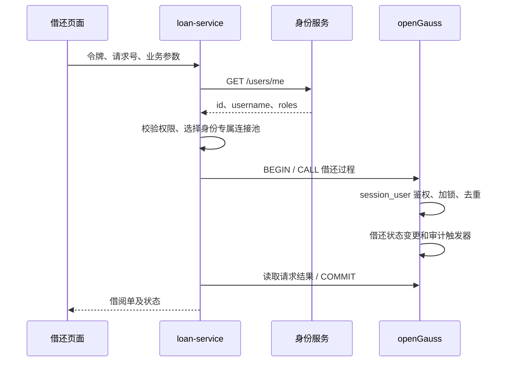

# C 借阅模块交付说明

## 1. 对齐 D 的范围

表结构以 D-数据库设计/loan/001_schema.sql 为准。移除了 C 初版独立建表和演示数据；这两个旧文件现在仅说明迁移顺序。没有改 D 的表、种子、dist 或账号名称。

所有读写使用 user_id、copy_id、loan_id、book_id、status、updated_at 等定稿字段。借阅状态是 BORROWED / RETURNED，副本状态是 AVAILABLE / BORROWED。服务生成 53 位精确整数范围内的随机编号，避开种子编号，数据库主键负责最终冲突检测；出现极低概率碰撞会报冲突，不覆盖记录。

## 2. 身份与数据库连接

A 的 GET /users/me 需返回：
`{"id":1,"username":"reader01","roles":["READER"]}`。

后端只接受已验证身份，核对编号、用户名和角色，选择固定数据库连接池：
1 → db_loan_reader01；2 → db_loan_reader02；3 → db_loan_librarian01。
每个身份独立连接池，口令只在环境变量中；不接收浏览器指定的数据库账号，不使用 SET ROLE。
GET /api/me 会返回 current_user / session_user，便于演示身份变化。

存储过程 SECURITY DEFINER 负责受限写入，执行者从 session_user 推导，不能通过过程参数假冒操作者。读者只能自借、自还，馆员可以代办。该权限以 D 的账号说明为准，与 C 初版“仅馆员归还”不同。
过程和审计函数的 PUBLIC 权限已撤销。部署脚本启用本会话 plsql_security_definer 兼容选项，仍需在锁定镜像实测过程定义和权限。
三个用户的映射是本次固定演示名单；新增应用账号需同时扩展连接配置和数据库身份函数。

D 目前授予读者全表 SELECT，因此应用接口负责过滤个人记录；不要声称数据库已实现行级读取隔离。C 未擅自改变 D 的授权矩阵。报表同步只接受 A 验证的 username=sync-bot；来源读取使用 C 自己的馆员连接，report 服务仍只写 report。

## 3. 事务和审计

借阅顺序：核对真实操作者 → 锁定 request_dedup → 检查请求号 → 锁定读者额度和副本 → 插入去重记录 → 写借阅 → 触发审计 → 修改副本 → 提交。
归还顺序一致；已归还的重复请求保持原归还时间，不重复触发审计。

request_no 是 D 定义的全局主键，限制 64 字符。request_dedup.user_id 表示操作者；实际借阅读者是 loan_record.user_id，馆员代借时二者不同。借阅重试核对操作者、操作、副本、读者和期限（由 due_at-borrowed_at 校验）；归还重试核对操作者和借阅编号。同键异参拒绝，新生成的候选 loan_id 不影响成功重试。

审计从同事务内的 request_dedup 找到请求号，记录 old_status/new_status/operator_user_id。触发器不修改库存。任一异常使去重、借阅、副本、审计一起回滚。

教学版本在 request_dedup 上使用 EXCLUSIVE 表锁串行借还，避免跨账号同请求号竞争、配额竞争和交叉锁死；不宣称高吞吐。业务接口事务超时 20 秒。异常后客户端保留请求号重试，不把断线视为借阅一定失败。

updated_at 在串行写入锁内以数据库当前时间和已有最大值生成，严格递增，避免事务开始时间早于上一页游标导致报表漏数据。所有借阅写入口必须遵守此规则；管理员直接 SQL 修改不在该保证内。

## 4. API

前缀 /api；除 /health 外携带 Authorization: Bearer token。业务列表每页 100 条，after 使用最后一条的 copy_id 或 loan_id。

| 接口 | 输入及用途 |
|---|---|
| GET /me | 已验证身份及实际数据库用户 |
| GET /copies?after=0 | 副本与本地书目快照 |
| POST /copies | 馆员：{bookId,barcode}，服务生成 copy_id |
| PUT /book-snapshots | 馆员：{bookId,title,isbn}，将 B 已确认书目信息写入 C 快照 |
| PUT /borrowers | 馆员：{userId,maxLoanCount,active}，使用 A 已创建的编号 |
| GET /loans?after=0&all=false | 默认仅自己的记录；all=true 仅馆员 |
| POST /loans | {readerId,copyId,days,requestKey}，1–30 天 |
| POST /loans/{id}/return | {requestKey}，读者自还或馆员代还 |
| GET /internal/loans/changes | sync-bot 专用，见 D 联调交接 |

400：请求参数非法；401：未认证；403：越权；409：业务冲突；503：数据库或身份服务不可用。数据库原始错误不返回浏览器。

## 5. 时序图

## 6. 验收和演示

先演示 reader01、reader02、librarian01 的数据库身份不同，再演示借阅、相同请求重试、同键异参冲突、归还和审计。
HTTP 验收脚本以 20 个请求竞争一个新副本，期望恰好一次成功，并检查跨读者访问和报表游标；它创建测试记录，使用专用测试库。
database_regression.sql 在 D 的干净种子上检查 SQL 写权限、真实 session_user、自借/越权、幂等、审计和事务回滚，全部测试变更最终回滚。
E 主备切换后，用同一请求号确认原结果，再发送新请求证明新主可写；主备环境未提供，不能提前填写成功截图或耗时。

## 7. 尚需整组联调

A 确认身份返回格式及 sync-bot；B 将页面纳入 Vue 布局，并对接快照更新；D 执行过程和授权后重新导出 dist；E 完成主备连接和恢复演练。C 已提供所需入口，但这些外部服务不在当前工作区。

技术依据：
https://docs.opengauss.org/en/docs/7.0.0/sql_reference/create_function.html
https://docs.opengauss.org/en/docs/7.0.0-RC3/sql_reference/create_procedure.html

