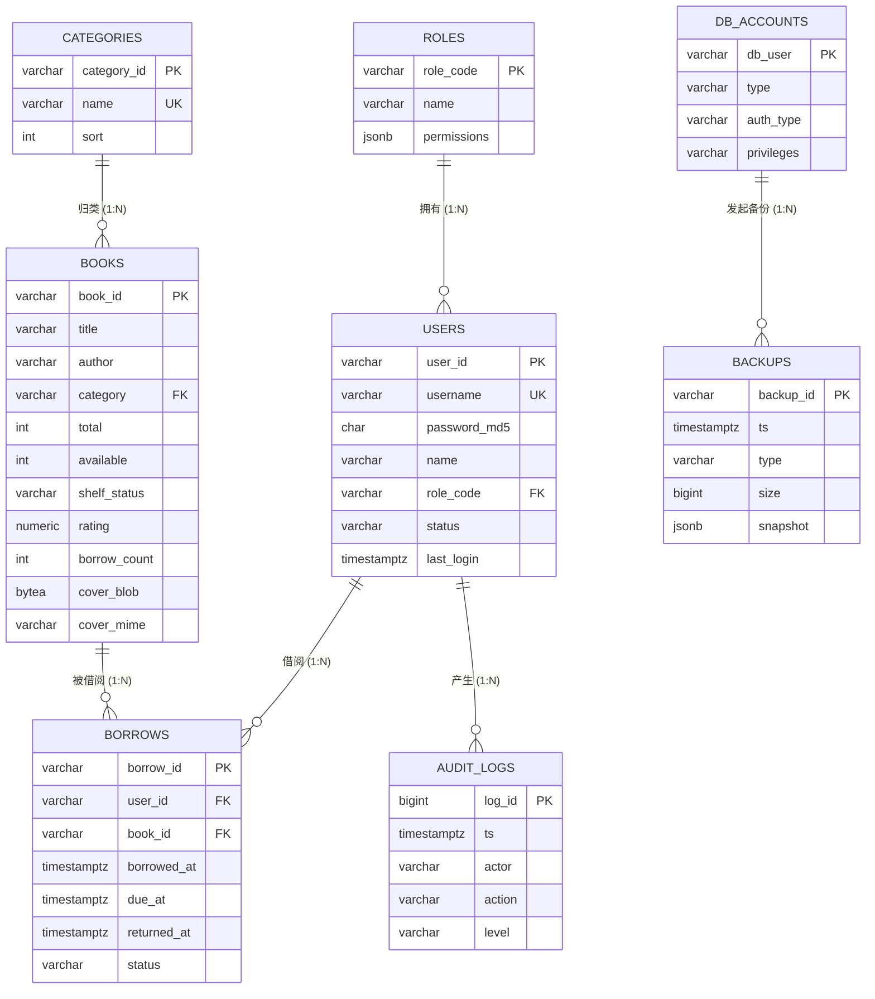

# BIT书屋 · 图书借阅管理系统设计文档

> 数据库课程设计 · 2026  
> 系统入口：`index.html`  
> 可打印版本：`docs.html`  
> 数据库脚本：`db/schema.sql`
>
> **阅读提示（2026-11-18 补）**：本文是**设计阶段**的说明文档，其中提到的 `db/schema.sql`、
> 浏览器 localStorage 数据层等已不适用——实际实现为「Vue 3 前端 + catalog/loan 两个 Spring Boot 服务 + openGauss」。
> 真实启动方式见根目录 `README.md`，实现现状与接口见 `docs/B-交接方案.md`。

---

## 1 需求分析

### 1.1 项目背景与目标

BIT书屋面向校园读者提供图书检索、借阅与归还服务。作为数据库课程设计，系统还需要覆盖多用户与 RBAC、数据库多用户（IAM）、多表联查与存储过程、密码摘要、读者评价、公告、本地导入导出、备份恢复与主备高可用等考核点。

系统目标：

1. 读者可完成“查书 → 借书 → 还书 → 查看借期”的完整闭环。
2. 管理员可在图形界面中维护馆藏、用户与权限、查看审计、执行 SQL、备份恢复、切换主备。
3. 所有关键业务规则由数据库对象（约束、触发器、存储过程）保证一致性。

### 1.2 角色与权限

| 角色 | 职责 | 权限边界 |
|---|---|---|
| admin 系统管理员 | 用户、备份、主备、审计、全部业务 | `*` 全部权限 |
| librarian 图书管理员 | 图书、借阅、查询、导入导出 | 无用户管理、备份恢复、主备切换 |
| reader 读者 | 浏览、借阅、归还本人图书 | 无管理控制台 |
| guest 访客 | 未登录浏览 | 仅图书只读 |

RBAC 权限矩阵在系统「用户与权限」页面可视化展示；前端隐藏入口只是体验优化，真实安全边界由后端接口再次校验。

### 1.3 功能需求

| 编号 | 功能 | 说明 |
|---|---|---|
| F01 | 首页与热门图书 | 馆藏统计、热门排行、分类筛选、关键词搜索、封面上传/展示 |
| F02 | 借阅 | 登录后选择图书，校验上限 5 本、重复借阅与库存，生成 30 天借期 |
| F03 | 归还 | 更新归还状态，触发器恢复库存；逾期扫描 |
| F04 | 多用户与 RBAC | 登录、MD5 摘要、角色权限、账号启停、重置密码 |
| F05 | 数据库多用户 / IAM | DBA、应用、只读、备份、审计五类数据库账户 |
| F06 | 多表联查与 SQL 组装 | 热门排行、借阅明细、读者汇总、库存预警 |
| F07 | 存储过程与触发器 | 借阅、归还、逾期扫描、热门、读者统计 |
| F08 | 导入导出 | CSV/JSON 本地预览与导入，图书/借阅/用户/全量下载 |
| F09 | 读者评价与十分制评分 | 归还后打星（必填）与文字（选填），平均星级 × 2 |
| F10 | 备份与恢复 | 服务器端快照、列表、恢复、下载/上传 |
| F11 | 主备服务器 | 拓扑、状态、手动切换、自动故障转移、节点恢复 |
| F12 | 业务流程与审计 | 8 步流程动画，关键事件写入审计日志 |
| F13 | 读者注册 | 自助注册读者账号并自动登录 |
| F14 | 馆内公告 | 管理员/馆员发布、编辑、置顶、删除；访客与读者只读 |

### 1.4 非功能需求

- **安全**：密码不以明文入库；参数化 SQL；输出转义；数据库最小权限；审计只追加。
- **可用性**：主备双节点，故障自动提升；前端展示连接状态并自动重连。
- **性能**：热点查询使用索引与 LIMIT；图片按需加载并缓存 ObjectURL。
- **可演示性**：所有技术点可在浏览器中操作并留下审计记录。

---

## 2 ER 图设计

### 2.1 实体与属性

| 实体 | 主键 | 主要属性 |
|---|---|---|
| users 用户 | user_id | username、password_md5、name、role_code、status、email、phone、created_at、last_login |
| roles 角色 | role_code | name、description、permissions(JSONB) |
| categories 分类 | category_id | name、sort |
| books 图书 | book_id | title、author、category、isbn、publisher、year、total、available、shelf_status、rating、borrow_count、cover_blob、cover_mime、description |
| borrows 借阅记录 | borrow_id | user_id、book_id、borrowed_at、due_at、returned_at、status、renew_count、operator |
| audit_logs 审计日志 | log_id | ts、actor、action、detail、level、node |
| db_accounts 数据库账户 | db_user | type、auth_type、privileges、status、last_login |
| backups 备份 | backup_id | ts、type、size、node、status、note、snapshot |

### 2.2 ER 图（Mermaid）



借阅在概念层是用户与图书的 M:N 关系，关系模型中拆分为 `borrows` 关联实体，保存借期、状态、归还时间与操作者。

### 2.3 关系模式与范式

- `roles(role_code, name, permissions, description)`，PK `role_code`
- `users(user_id, username, password_md5, name, role_code, status, ...)`，PK `user_id`，FK `role_code → roles`
- `categories(category_id, name, sort)`，PK `category_id`，UNIQUE(name)
- `books(book_id, title, author, category, total, available, shelf_status, ...)`，PK `book_id`，FK `category → categories(name)`，CHECK `0 <= available <= total`，CHECK `shelf_status IN ('on_shelf', 'warehouse', 'off_shelf')`
- `borrows(borrow_id, user_id, book_id, borrowed_at, due_at, returned_at, status)`，PK `borrow_id`，FK `user_id`、`book_id`，CHECK `due_at > borrowed_at`
- `audit_logs(log_id, ts, actor, action, detail, level, node)`，PK `(log_id, ts)`，按时间分区，只追加
- `db_accounts(db_user, type, auth_type, privileges, status)`，PK `db_user`
- `backups(backup_id, ts, type, size, node, status, note, snapshot)`，PK `backup_id`

满足 3NF。`books.available` 与 `books.borrow_count` 是受控冗余字段：由触发器维护，用于高频库存查询和演示；导入/恢复时按在借记录重新计算。

---

## 3 功能设计

### 3.1 功能结构

- **读者门户**：首页（最近 3 条公告、新上架图书、搜索与热门图书）、全部公告页、我的书库（我的借阅 / 我的评价）、借阅、归还、登录/切换账号。
- **管理控制台**：运营概览、图书管理、借阅管理、读者评价、公告管理、用户与权限、数据库实验台、导入导出、备份恢复、主备服务器、审计日志。
- **数据库对象**：8 张表、3 个触发器、5 个存储过程/函数、多个索引、审计分区、两个数据库角色。
- **高可用运维**：WAL 流复制、自动故障转移、连接串路由、全量备份、快照恢复、本地文件导入导出。

### 3.2 业务流程

借阅：

```
登录(MD5 校验) → 检索(books ⋈ categories) → 选择图书
→ 前端组装参数化请求 → CALL sp_borrow_book
→ 触发器校验上限/重复/库存 → INSERT borrows
→ 触发器 available-1 + 审计 → 事务提交 → WAL 复制备节点
```

归还：

```
CALL sp_return_book → 校验状态 → UPDATE status='returned', returned_at
→ 触发器 available=LEAST(total, available+1) + 审计 → 前端刷新
```

状态机：`borrowing → returned`；到期未还由 `sp_overdue_check` 置为 `overdue`，归还后进入 `returned`。

### 3.3 数据库编程对功能设计的支撑

#### 3.3.1 GaussDB 触发器、存储过程与“重组”

触发器与业务写入处于同一事务，保证“借阅记录写入”与“库存扣减”原子发生：

| 对象 | 时机 | 职责 |
|---|---|---|
| `trg_validate_borrow` | BEFORE INSERT | 校验 `due_at > borrowed_at`、借阅上限 5 本 |
| `trg_after_borrow` | AFTER INSERT | 库存 -1；库存不足回滚；写审计 |
| `trg_after_return` | AFTER UPDATE | 归还时库存 +1（不超过 total）；写审计 |

“重组”可理解为物理层维护：`VACUUM` 回收频繁更新产生的死元组，`REINDEX` 重建索引，审计表按月分区并归档历史数据，必要时在线扩容。逻辑一致性由触发器/过程保证，物理性能由重组保证。

#### 3.3.2 存储过程与函数

| 对象 | 参数 | 功能 |
|---|---|---|
| `sp_borrow_book` | user_id, book_id | 校验读者/上限/重复/库存，写入借阅记录 |
| `sp_return_book` | borrow_id | 更新归还状态，触发器恢复库存 |
| `sp_overdue_check` | 无 | 扫描到期未还，批量置为 overdue |
| `sp_hot_books` | limit | 近 30 天借阅 + 历史热度排行 |
| `sp_user_summary` | user_id | 累计/在借/逾期统计 |

价值：减少网络往返、复用业务规则、收敛权限（应用只授予 EXECUTE）、统一审计。

#### 3.3.3 主备服务器实现

1. 主节点把 WAL 持续发送到备节点，备节点回放保持同步；同步复制保证强一致，异步复制换取低延迟。
2. DCS/etcd 检测心跳，超过阈值判定主节点故障并提升备节点，避免脑裂。
3. 应用连接串同时配置两个节点，`target_session_attrs=read-write` 或虚拟 IP 自动路由到新主节点。
4. 前端展示拓扑、心跳、复制延迟、CPU/内存与事件日志；提供手动切换、模拟关闭主节点、恢复节点按钮。
5. 故障转移步骤：检测心跳 → 仲裁选主 → 提升备节点 → 更新连接串/VIP → 前端自动重连。

#### 3.3.4 应用多用户与数据库多用户

- **应用用户**：admin、librarian、reader，按角色授予权限；前端隐藏入口，后端接口再次校验。
- **数据库账户**：`gauss_dba`、`tata_app`、`tata_readonly`、`tata_backup`、`tata_audit` 由 IAM 统一管理，浏览器不接触数据库密码。
- **最小权限**：`tata_app` 只拥有业务表 SELECT/INSERT/UPDATE/DELETE 与过程 EXECUTE；`audit_logs` 禁止应用删除；报表账户只读；备份账户仅用于备份任务。
- **密码**：课程要求 MD5，登录时计算 `MD5(输入)` 与 `users.password_md5` 比对；生产应改用 bcrypt/Argon2 + 盐 + HTTPS。
- **防注入**：查询参数通过命名参数绑定，后端使用 PreparedStatement 或 `EXECUTE ... USING`。

### 3.4 前端关键实现

- **Vue 3 单页应用**：使用组合式 API 与 hash 路由组织首页、公告、全部图书、我的书库与控制台；公共页面、弹窗、借阅/归还/评价均由 Vue 组件管理。数据访问集中在 `src/services/api.js`，当前对接 `db.js` 演示数据层，后续可替换为 Spring Boot + openGauss 微服务接口。
- **多表联查**：四种场景（热门排行、借阅明细、读者汇总、库存预警），展示 SQL 模板、参数值、结果网格与模拟执行计划。
- **读者评价**：`reviews` 保存图书、读者、1–5 星评分、可选文字与状态；仅归还后可提交，评分必填；图书得分 = `AVG(rating) × 2`。
- **馆内公告**：`announcements` 保存标题、正文、置顶与发布状态；管理员/馆员可写，访客与读者只读已发布公告。首页仅展示最近 3 条，完整列表在「馆内公告」页查看。
- **导入导出**：FileReader 读取 CSV/JSON，识别表头并预览；导出用 Blob + download，CSV 带 BOM。
- **备份恢复**：应用按钮发起服务器端快照（真实系统由后端执行 `gs_dump` / `pg_basebackup`），本地 JSON 下载/上传是另一条链路。
- **主备切换**：拓扑图、节点状态、手动切换、模拟关闭主节点后的 5 步自动转移、恢复节点。

---

## 4 总结

### 4.1 作业要求项达成说明

| 要求 | 实现 | 演示位置 |
|---|---|---|
| 多用户、数据库多用户（IAM） | 应用角色 + 5 类数据库账户 | 用户与权限 |
| 应用层多用户、RBAC | 权限矩阵、入口隐藏、二次校验 | 用户与权限 |
| 多表联查、组装 SQL、存储过程 | 四类查询 + 五个过程/函数 | 数据库实验台 |
| 密码 MD5 | 登录实时预览，仅存摘要 | 登录 / 用户与权限 |
| 本地导入导出 | FileReader / Blob，预览与合并 | 导入导出 |
| 读者评价与公告（扩展） | 星级评分、平均分折算十分制、公告发布与只读查看 | 读者评价 / 馆内公告 |
| 备份恢复按钮 | 服务器端快照 + 本地备份 | 备份与恢复 |
| 主备切换与状态 | 拓扑、心跳、自动故障转移 | 主备服务器 |
| 业务流程 | 8 步动画 + 审计 | 运营概览 |
| 现场演示/录屏 | 演示账号与脚本 | 登录弹窗 / docs.html 4.4 |

### 4.2 开发遇到的问题与解决方案

| 问题 | 原因 | 解决方案 |
|---|---|---|
| 预览一直显示旧版本 | 预览层/浏览器缓存旧 HTML，条件请求 304 | `Cache-Control: no-store`、移除 ETag、资源加版本号、强制刷新 |
| 子路径预览白屏 | 资源使用根绝对路径 | 全部改为 `./` 相对路径 |
| 并发借阅超卖 | 先查后写存在竞态 | `SELECT ... FOR UPDATE` 行锁 + 触发器库存非负约束 |
| 重复归还库存超出 | 多次归还重复 +1 | 校验 `status <> 'returned'`，触发器 `LEAST(total, available+1)` |
| localStorage 容量不足 | Base64 图片与快照体积大 | 单图 512 KB、备份最多 4 份、异常提示 |
| ObjectURL 内存泄漏 | 每次渲染创建新 URL | 按图书 ID 缓存，替换时 revoke |
| 切换后前端连旧节点 | 连接串只配置一个主机 | 双主机 + `target_session_attrs=read-write` |
| MD5 安全性不足 | 无盐、易碰撞 | 课程演示保留；文档说明生产改用 bcrypt/Argon2 |
| CSV 中文乱码 | Excel 无 BOM 时编码判断错误 | 导出加 UTF-8 BOM，导入去 BOM |
| 重复导入图书 | CSV 缺少统一主键 | 按编号或书名+作者合并，返回统计 |

### 4.3 小组合作的方法

| 角色 | 职责 | 交付物 |
|---|---|---|
| 组长 / 数据库设计 | 需求、ER 图、关系模式、触发器与过程、主备方案 | schema.sql、文档 2–3 章、答辩主讲 |
| 后端 / 高可用 | 接口鉴权、备份恢复、主备脚本、审计 | API 说明、故障转移演示 |
| 前端 / 交互 | 门户、注册登录、读者评价、公告、控制台、实验台、导入导出 | 页面、演示脚本、录屏 |
| 测试 / 文档 | 用例、边界测试、数据准备、排版与彩排 | 测试记录、演示账号、PDF/视频 |

协作方法：

1. 每周一次站会同步进度与阻塞；需求变更先改文档再改代码。
2. Git 分支按功能拆分，提交信息说明“做了什么、为什么”，合并前互相 Review。
3. 先确定表结构与接口字段再并行开发；固定演示数据保证环境一致。
4. 数据库同学讲触发器/事务，前端同学讲交互/错误提示；答辩前每人能独立演示。
5. 每次演示后记录卡顿与老师提问，形成问题清单并迭代。

### 4.4 现场演示与录屏脚本

| 时间 | 画面 | 操作与讲解 |
|---|---|---|
| 0:00 | 首页 | 馆藏统计、热门排行、搜索筛选 |
| 0:50 | 登录 | reader / librarian / admin 三种角色；MD5 实时预览 |
| 2:00 | 借阅/归还 | reader 借书，库存 -1；归还库存恢复；审计留痕 |
| 3:10 | RBAC | librarian 可见范围；reader 访问控制台被拒绝；IAM 账户 |
| 4:10 | 数据库实验台 | 四种联查、参数化 SQL、执行计划、存储过程、触发器 |
| 5:20 | 读者评价 / 公告 / 导入导出 | 归还后打星评价并观察十分制得分；发布公告；导出与导入预览 |
| 6:20 | 备份恢复 | 创建快照 → 修改 → 恢复；说明前后端职责 |
| 7:20 | 主备服务器 | 拓扑与心跳；关闭主节点自动转移；恢复节点；手动切换 |
| 8:40 | 总结 | 业务流程动画 + 审计日志收尾 |

### 4.5 不足与改进

1. 当前为纯前端演示，数据库/主备/备份为浏览器内模拟；生产需接入真实后端与 GaussDB。
2. MD5 仅满足课程要求，生产应改为 bcrypt/Argon2 + 盐，并增加登录限流与会话过期。
3. 主备演示未覆盖脑裂、双主、复制延迟过大等异常，生产需 DCS 仲裁与监控告警。
4. 评价与公告为演示级实现；生产环境应增加敏感词审核、评价申诉与公告受众范围控制。
5. 权限校验目前由前端模拟，真实系统必须后端逐项校验并记录失败审计。

---

## 附录

### A. 演示账号

| 账号 | 密码 | 角色 |
|---|---|---|
| admin | admin123 | 系统管理员 |
| librarian | lib123 | 图书管理员 |
| reader | read123 | 读者 |

### B. 交付物

- `index.html`、`styles.css`、`src/**`（Vue 3）、`db.js`、`console*.js`：可运行系统
- `docs.html`：可打印设计文档
- `docs/tata-db-course-design.md`：本文档
- `db/schema.sql`：GaussDB/openGauss 建表、索引、触发器、存储过程、IAM 与主备配置示例

### C. 运行方式

静态站点，无需构建。在项目目录启动静态服务器（如 `npx serve -s . -l 30001`），浏览器访问即可。数据保存在 localStorage，可在「导入导出 → 重置演示数据」恢复初始状态。
