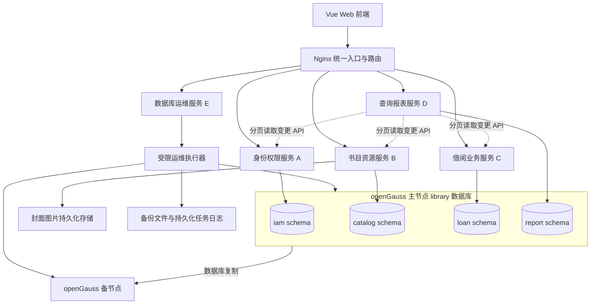

# 校园图书借阅管理系统五人项目总体方案

> 文件性质：项目组分工方案的原文留档。
> 转录说明：以下正文按项目组提供的方案保存，未改动编号与措辞；原文编号从 §2 直接到 §4、从 §12 直接到 §15，缺 §3、§13、§14，属于原文自身的编号空缺，不是转录遗漏。
> 格式说明：原文 §2 后「高斯数据库：」的 17 项以空行分隔、无表头，第 3/4 列留空；为便于阅读，本文件仅将其整理为标准 Markdown 表格，序号与要求措辞未改。
> 相关文件：`docs/handover.md`（B 组前端交接文档）、`docs/tata-db-course-design.md`（现有课程设计文档）。

---

## 1 项目结论与提交方式

建议选题为：**基于微服务架构与 openGauss 的校园图书借阅管理系统**。

按目前提供的技术要求，可以开发一个项目：共用一个代码仓库、同一组业务服务、同一套 openGauss 数据模型和演示数据，分别准备两门课的报告、演示脚本和提交包。软件体系结构课重点证明服务如何划分、通信、封装、部署和评估；高斯数据库课重点证明权限、SQL、存储过程、触发器及数据库运维确实工作。


### 1.1 要求的适用范围

| 材料                            | 本方案采用的内容                                                                  | 需要区分的事项                                           |
| ------------------------------- | --------------------------------------------------------------------------------- | -------------------------------------------------------- |
| 本次课堂照片                    | 选择微服务题目；容器化；云平台部署；推荐华为云、openGauss                         | 不把学长 Serverless 方案当作本组选题                     |
| 当前目录的大作业要求 PDF        | 需求、架构、详细设计、架构评估、源码、PPT、VMware 环境、部署文档、15 分钟录屏     | PDF 内有 2025 年字段，截止日期及加分比例须以本届通知为准 |
| 高斯数据库《实验与作业》第 9 页 | 五人组及数据库开发作业的全部功能、环境、文档、用户手册、10 分钟课堂演示、RAR 命名 | 第 3-7 页个人实验、第 10 页个人研究不自动被小组项目替代  |
| 学长目录                        | 文档结构、截图组织、源码说明、部署流程的呈现方式                                  | 学长验收日期及性能数字不适用于本组                       |

## 2 业务范围与最小交付版本

系统服务于小型学院图书室。读者可以查询图书、查看封面、申请借阅和查看个人记录；馆员管理书目及实体副本、办理借还；数据管理员完成多条件查询及导入导出；运维管理员查看数据库状态并执行备份、恢复和主备切换。

基本业务闭环：**馆员录入书目和实体副本 → 读者检索 → 借阅成功 → 馆员归还 → 统计查询 → 管理员备份与恢复验证**。

| 优先级 | 功能             | 完成边界                                                             |
| ------ | ---------------- | -------------------------------------------------------------------- |
| 必做   | 登录、角色、权限 | 至少读者、馆员、数据分析员、运维管理员；后端和数据库两层授权         |
| 必做   | 书目管理         | 分类、作者、书名、ISBN、封面；维护实体副本                           |
| 必做   | 借还业务         | 借阅、归还、记录查询、重复请求处理、同一副本并发竞争                 |
| 必做   | 多表联动查询     | 分类/图书/借阅状态/时间筛选，参数化 SQL 预览与结果展示               |
| 必做   | 数据库程序       | 至少借阅、归还两个存储过程，一个审计触发器                           |
| 必做   | CSV、TXT         | 按明确模板导入书目或副本，导出书目及借阅统计，显示导入错误行         |
| 必做   | 图片             | 图书封面显示；图片文件在持久化目录或对象存储，数据库存元数据和地址   |
| 必做   | 运维控制台       | 真正显示服务和数据库状态，执行备份、恢复验证、主备切换并显示任务结果 |
| 必做   | 部署和证据       | Docker 封装、云端运行、可复现的本地演示环境、架构评估记录            |
| 选做   | 智能检索         | 自然语言转受控查询条件，调用现有查询 API；失败时普通检索仍可用       |
| 选做   | 业务增强         | 预约、续借、站内通知、热度推荐、讲解视频                             |

数据库作业写的是“图片显示或流媒体播放”，图书封面已覆盖这一项；不需要为此再开发视频转码。首版也不加入支付、商城、物流、复杂推荐、跨校区库存等功能。

高斯数据库：

| 序号 | 要求 | 说明 | 证据 |
| --- | --- | --- | --- |
| 1 | ECS多用户 |  |  |
| 2 | 数据库内部多用户 |  |  |
| 3 | 应用系统多用户 |  |  |
| 4 | 应用系统权限设置 |  |  |
| 5 | 应用系统用户密码加密 |  |  |
| 6 | 触发器 |  |  |
| 7 | 存储过程 |  |  |
| 8 | 前端多表联动数据查询 |  |  |
| 9 | SQL组装 |  |  |
| 10 | SQL注入检查 |  |  |
| 11 | 数据导出导入 |  |  |
| 12 | 图片存储与实现 |  |  |
| 13 | 流媒体播放 |  |  |
| 14 | 备份数据库 |  |  |
| 15 | 恢复数据库 |  |  |
| 16 | 主服务器设置 |  |  |
| 17 | 主备服务器自动切换 |  |  |

## 4 总体架构

建议采用 **四个业务微服务 + 一个运维管理服务**。每个服务有自己的进程、构建产物、Dockerfile、接口和健康检查。五个人可以分别主责一个服务，但团队人数不构成服务拆分的技术理由。



图中的 schema 是逻辑隔离，不是四台数据库。每个服务只持有本服务所需的数据库凭据，禁止跨服务直接写表。数据库实例共用，意味着存储故障、连接资源和整体维护仍有共同影响，这是课程规模下的明确折中，需要在评估报告中说明。资源充足时可以沿同样的服务边界迁移到独立数据库，不必先创建五套主备集群。

### 4.1 服务与数据所有权

| 服务             | 主要职责                                         | 自有数据                                                                           | 代表接口                                                                     |
| ---------------- | ------------------------------------------------ | ---------------------------------------------------------------------------------- | ---------------------------------------------------------------------------- |
| identity-service | 登录、角色、应用用户与数据库身份映射             | app_user、app_role、user_role、db_identity_mapping                                 | POST /auth/login；GET /users/me                                              |
| catalog-service  | 书目、作者、分类、封面、书目导入                 | book、author、book_author、category、media                                         | GET /books；POST /books/import                                               |
| loan-service     | 实体副本、借阅资格、借还事务、业务审计           | book_copy、borrower_account、loan_record、request_dedup、loan_audit、book_snapshot | POST /copies；POST /loans；POST /loans/{id}/return                           |
| report-service   | 联动查询、参数化查询构建、统计导出、报表数据同步 | reader_dim、book_dim、category_dim、loan_fact、sync_checkpoint                     | POST /reports/query；GET /reports/export                                     |
| dbops-service    | 服务器状态、备份、恢复验证、主备切换、任务轮询   | 独立持久化的任务日志和配置；目标业务库停机时仍能显示任务                           | GET /ops/status；POST /ops/backups；POST /ops/restores；POST /ops/switchover |

表名为建议逻辑模型，详细设计时可以在不破坏边界的前提下精简。开发、迁移使用的 schema 所有者账户与运行账户分开，日常服务不使用数据库超级管理员。

**为什么副本和借阅放在同一服务：** 书目描述“这是哪本书”，副本描述“这个条码对应的实体书现在能否借出”。库存状态更新和借阅记录写入属于同一业务事务，放在 loan-service 内可以通过本地数据库事务一次完成，首版无需引入分布式事务框架。

### 4.2 服务通信和分层

前端只访问统一入口。服务使用 HTTP/JSON 和明确的接口契约，统一分页、时间格式、错误码、请求标识。Nginx 负责转发，各服务独立验证身份和授权，不能把“前端隐藏按钮”当成权限保护。

服务内部遵循 Controller → Service → Repository/JDBC 的分层。共享库仅放通用错误模型、接口 DTO、日志和鉴权工具，不共享可跨 schema 操作的 Repository，也不把所有业务逻辑放到 common 模块。

固定的课程演示拓扑可以通过 Compose 服务名和环境变量配置地址，不必把注册中心、配置中心、消息队列、Redis、Kubernetes、服务网格同时引入。选做这些组件时，应说明解决的实际问题，并增加对应验证证据。

## 5 五人分工与负责人

### 5.1 可直接填入小组名单的角色名称

| 成员 | 名单中的角色负责人               | 主责开发                                                                | 主责页面                       | 主责文档和验收                                                      |
| ---- | -------------------------------- | ----------------------------------------------------------------------- | ------------------------------ | ------------------------------------------------------------------- |
| A    | 组长、总体架构与身份权限负责人   | identity-service、接口规范、入口路由整合、鉴权                          | 登录、用户角色管理             | 需求与总体架构、架构评估统稿、PPT 总装；讲解服务划分和权限          |
| B    | 前端规范与书目资源负责人         | catalog-service、封面、书目导入、前端公共布局                           | 首页、书目列表详情、书目维护   | 功能设计、源码结构；演示查询、图片和书目导入                        |
| C    | 借阅业务与事务负责人             | loan-service、副本状态、存储过程、触发器、幂等                          | 借阅、归还、我的借阅、馆员办理 | 借还详细设计、时序图、事务及并发测试；演示存储过程与触发器          |
| D    | 数据库设计与查询分析负责人       | report-service、报表投影同步、联动查询、SQL 构建、导出；统筹 DDL 和授权 | 高级查询、统计、数据导出       | ER 图、数据字典、权限矩阵、数据库测试报告；演示联表与参数化查询     |
| E    | 容器部署、数据库运维与测试负责人 | dbops-service、运维执行器、主备环境、备份恢复、构建发布流程             | 运维控制台、任务进度与结果     | Docker/云部署文档、环境交付、用户手册汇编、录屏总装；演示恢复与切换 |

**每个人都写代码、测试和自己模块的文档。** B 维护前端组件及页面规范，A、C、D、E 自己完成对应页面，避免所有前端工作集中在 B。E 提供 Dockerfile 模板，各成员封装自己的服务。

### 5.2 协作边界

| 跨模块事项          | 最终负责人 | 必须配合的人                     | 交付标准                                       |
| ------------------- | ---------- | -------------------------------- | ---------------------------------------------- |
| 需求冻结与接口契约  | A          | 全员                             | 字段、接口、错误码、权限和负责人明确           |
| 数据库身份映射      | A          | D；E 提供连接信息                | 应用角色可映射到真实数据库用户，授权正反例通过 |
| DDL、索引与迁移规则 | D          | A/B/C 各自编写本服务 SQL         | 每个变更可从空库重建，所有权明确               |
| 借还事务及触发器    | C          | D 复核，A 复核身份来源           | 重复、并发、回滚、越权场景可验证               |
| 查询投影同步        | D          | A/B/C 提供受控读取 API           | 不直查其他服务私表；同步进度和更新时间可见     |
| 主备、备份恢复      | E          | D 负责数据库对象核验，A 协助部署 | 实际数据库角色和数据变化可证实                 |
| 前端集成            | B          | 全员                             | 页面可路由，统一权限和错误显示                 |
| 系统集成验收        | A          | E 组织测试，全员修复各自缺陷     | 在干净环境重建并完成两套演示                   |

每周保留功能交付、提交记录、评审记录、测试证据和文档署名。贡献以实际完成和难度衡量，不按代码行数，也不预先指定谁拿高低等级。单人预计任务过载时，先砍选做项，再把明确子任务转交，保留主责人。

## 6 高斯数据库要求逐条落地

| 作业要求                               | 本系统实现方式                                                                  | 演示证据                                                                     | 主责                 |
| -------------------------------------- | ------------------------------------------------------------------------------- | ---------------------------------------------------------------------------- | -------------------- |
| 数据库内部多用户、与应用用户对应、权限 | 创建真实数据库登录用户和授权角色；后端按服务及登录身份映射到受限数据库连接      | 登录不同应用账号，展示实际 current_user/session_user；允许和拒绝的数据库访问 | A、D                 |
| 触发器                                 | loan_record 的 INSERT/状态 UPDATE 触发审计记录，记录前后状态、操作者和请求号    | 借还一次后查询 loan_audit；事务回滚时审计同步回滚                            | C                    |
| 存储过程                               | sp_borrow_copy、sp_return_copy；可选 sp_reader_summary                          | 页面参数经后端传给过程；展示调用结果及异常返回                               | C                    |
| 前端多表联动查询                       | 分类、图书、借阅状态、日期条件联动；在 report schema 对读者、图书、借阅事实联表 | 更改分类联动图书候选项，查询列出书名、读者、日期、状态                       | D                    |
| 组装 SQL、存储过程传参                 | 条件构建器形成结构化请求；后端生成带占位符 SQL；页面展示模板和参数              | 不同筛选生成不同 SQL 模板；存储过程的输入输出参数可见                        | D、C                 |
| 用户密码加密、SQL 注入检查             | 应用密码使用带盐的自适应单向哈希；SQL 参数绑定、字段与排序白名单                | 数据库中没有应用明文密码；注入用例不能改变查询语义或绕过权限                 | A、D                 |
| CSV、TXT 导入导出                      | 书目/副本模板导入和报表导出，支持约定分隔符、UTF-8 编码、校验和错误行报告       | 各演示一种格式的导入和导出；重复导入不产生未定义重复记录                     | B、D；C 支持副本接口 |
| 图片显示或流媒体播放                   | 图书封面显示                                                                    | 新录入图书封面在页面显示，重启后仍可访问                                     | B                    |
| 前端服务器状态                         | 服务健康、数据库连接、实际主备角色、复制状态、最近采集时间                      | 真实采集与故障状态变化，过期数据标为未知/过期                                | E                    |
| 前端备份与恢复                         | 后端任务调用数据库工具，恢复到验证数据库，核对数据及对象                        | 任务日志、备份文件、恢复前后对照、恢复库查询                                 | E、D                 |
| 前端主备切换                           | 两个真正配置复制关系的节点，执行计划内 switchover                               | 前后主备角色互换、业务重新连接、切换后新借阅写入成功                         | E、C                 |
| 演示环境、文档、源码、用户手册         | 共用项目源码与环境，数据库专项说明和操作手册独立成册                            | 另一位组员按手册在干净环境复现                                               | E 统筹、全员         |
| 10 分钟演示与命名                      | 数据库专用演示脚本；2026-作业1-小组名.rar                                       | 压缩包目录及限时彩排                                                         | D、E                 |

### 6.1 数据库用户与应用角色

推荐为验收使用的少量应用账号配置明确的数据库登录身份，并按服务分隔，例如 reader01 对应 db_catalog_reader01、db_loan_reader01，librarian01 对应 db_catalog_librarian01、db_loan_librarian01，analyst01 对应 db_report_analyst01。相同业务角色复用授权角色，权限按 schema、视图、表或过程授予，禁止业务账户具有 SYSADMIN 权限。身份服务自身使用单独的运行账户查询登录信息。

登录后，服务端根据已验证的用户和角色，从固定映射中选择数据库连接；浏览器不提交可自由指定的数据库用户名、密码或 schema。服务间同步另用受限的内部身份，不借用管理员身份。

这样在同一服务中，reader01 与 reader02 分别使用 db_loan_reader01 与 db_loan_reader02，可直接演示“应用用户切换后，实际数据库用户也变化”。账户数与连接池规模要受控，课程演示不必开放无限自助注册。如果教师明确接受按应用角色映射，才可进一步简化为每类角色一个数据库登录账户。

按数据库身份隔离连接池，避免复用一个高权限池后遗漏角色清理。若最终采用 SET ROLE/会话上下文方案，必须验证归还连接前的状态清理，并测试“管理员请求之后的读者请求”不会继承权限。课件 openGauss 管理第 27 页明确提醒了连接池会话状态问题。

数据库的表级授权和应用的数据行权限是两个问题。普通读者查询个人借阅时，user_id 必须来自服务端验证过的身份，不能相信浏览器传入的其他用户编号；还须演示同角色用户之间不能互看私人记录。

### 6.2 最小数据模型

建议核心关系如下，真实外键放在同一服务所属的 schema 内；跨服务只保留标识符和受控快照。

- catalog：category → book；book ↔ author 通过 book_author 关联；book → media。
- loan：borrower_account → loan_record；book_copy → loan_record；loan_record → loan_audit。副本书目信息使用本地 book_snapshot 展示。
- iam：app_user ↔ app_role 通过 user_role 关联；身份映射只在受控后端读取。
- report：reader_dim、book_dim、category_dim 与 loan_fact 组合查询，记录源系统编号和同步时间。

重要约束包括用户名唯一、ISBN 按项目约定处理、实体条码唯一、借阅状态枚举约束、幂等请求号唯一、必要的主外键。索引从“读者查自己的未还记录”“日期和状态查询”“分类检索”等具体 SQL 出发设计，用执行计划说明作用。

### 6.3 借还过程与触发器的职责

sp_borrow_copy 接收服务端确认的读者编号、实体副本编号、借阅期限及幂等请求号。一次本地事务内校验借阅资格、锁定读者配额和实体副本、检查可借状态、写入借阅记录、更新副本状态。规定统一加锁顺序，避免借还路径相互倒置。

sp_return_copy 检查借阅单状态，更新归还时间并释放实体副本。重复归还返回已完成结果，不重复改变库存。幂等键绑定操作者、操作类型和业务参数，不能让同一个键被用于不同借阅内容。

业务规则和状态变更集中在过程/事务中；触发器只负责审计。不要让 Java、存储过程和触发器三处分别扣减同一库存。审计触发器需要捕获 INSERT 和状态 UPDATE，但不代表“时间到了自动触发”；逾期可由查询计算，后续需要持久化状态时再加调度任务。

数据库异常须由后端转成可解释的错误，例如“该副本已借出”“已达到借阅上限”。事务失败时借阅记录、库存和审计一起回滚。跨服务 HTTP 调用不能被标注为“自动受到一个本地事务保护”。

## 7 多表查询与微服务隔离如何兼容

基础查询可在服务内部联表，例如 catalog 内对书目、作者、分类联表。跨域统计由 report-service 保存专门用于查询的投影表，再在自己的 schema 内执行 JOIN。

首版可采用定时调用内部 API 同步，默认每 30 秒尝试一次；支持人工刷新、分页、主键幂等写入、删除标记和失败重试。同步游标至少区分更新时间和编号，成功写入后再推进游标。前端显示各来源最后成功同步时间，故障时明确提示数据可能滞后。30 秒是计划的同步周期，不能据此承诺任何故障下数据延迟都小于 30 秒。

报表关闭或同步失败不阻塞借还事务。借阅结果以 loan-service 为准，统计可能稍后更新。这是业务事务与分析查询之间的一致性取舍。

不让 report-service 使用超级用户直接 JOIN 所有服务的私有表，也不在多个服务间创建触发器互相改表。若后来引入消息队列，则同时解决事务提交与事件发布、重复消费和失败重放；仅增加一个队列不能自动保证数据不丢失。

### 7.1 SQL 构建器

前端传递结构化条件，例如分类、起止日期、借阅状态、输出列和排序方式。后端只允许预定义的表、字段、操作符和排序项，值使用 PreparedStatement/JDBC 参数绑定。页面可以显示生成的 SQL 模板和独立参数列表，以便课堂解释“组装 SQL”。

不把正则检查或“过滤几个 SQL 关键词”当作注入防护。导出与列表必须使用同一权限过滤规则，避免列表看不到的记录通过导出泄露。若教师进一步要求自由 SQL 输入，再增加隔离的只读实验区，不开放通向业务库管理员权限的通用执行入口。

## 8 数据库运维设计

### 8.1 部署拓扑

建议逻辑拓扑为一个应用节点和两个数据库节点。应用节点运行前端、统一入口和五个服务；数据库 A、B 建立真实复制关系。节点可以部署在 Linux 虚拟机或 ECS 上。首周先确定操作系统、CPU 架构、数据库版本和 JDBC 驱动的兼容组合。

资源不足时可在同一物理宿主机上运行多个虚拟机/隔离实例，用来演示数据库复制与角色切换，但报告应写明这不能证明宿主机级容灾。独立微服务也不意味着整个系统已经高可用：单个入口、应用节点、存储等仍可能是单点。

推荐先使用自建 openGauss 完成教学验证，便于观察用户权限和数据库工具执行。若采用托管 GaussDB，需要先核实所选产品/实例形态是否允许课程要求的恢复和主备控制，以及是否可从自建前端调用对应管理接口。GaussDB、GaussDB(for MySQL)、openGauss 的产品接口及 SQL 支持不可混为一谈。

### 8.2 前端控制与执行链路

前端点击操作后，dbops-service 校验运维权限，创建带编号的后台任务，由受限执行器执行固定动作。前端轮询任务状态，展示开始时间、阶段、结果、退出码和脱敏日志。主备切换或恢复时目标业务库可能暂时不可用，因此任务日志保存在独立持久化目录，不能完全依赖正被恢复的数据库。

执行器只接受定义好的动作和受限参数，不接受任意 shell 字符串。数据库操作凭据和操作系统维护身份只在后端使用。恢复、切换属于产品里的重要管理动作，应显示目标环境并要求管理员明确确认。

### 8.3 备份与恢复

最小可行方案使用 gs_dump 生成自定义归档，通过 gs_restore 恢复到独立验证数据库。界面显示备份时间、对象范围和文件标识。恢复后核对关键表行数、指定记录、外键/索引、视图、过程和触发器，并执行一次查询或借还验证。

一个库的逻辑备份不代表包含集群级角色和外部图片。提交包同时保存可重建的角色/授权脚本，或选择与版本匹配的全局对象备份方式；图片目录/对象存储有单独备份清单。验证库的表所有者和授权恢复要有明确处理步骤。

演示建议：备份包含“演示图书 A”的数据库 → 在演示数据上修改该书信息 → 恢复到验证库 → 页面查询验证库并显示备份时的原记录。这样可以证明真实恢复，不要求现场覆盖当前正在运行的业务库。若教师要求原库恢复，再使用专用演示环境进入维护状态完成覆盖演练。

### 8.4 主备切换

必做范围为**计划内主备切换**：先查询复制状态，确认主备正常，再在预定备节点执行所选版本规定的 switchover 流程，等待角色变化，核对新的主节点可写、旧主节点转为备，必要时刷新部署管理元信息。超时必须查询实际状态，不能盲目重复发起切换。

业务连接需具备重新连接新主节点的能力。使用匹配版本 openGauss JDBC 的多地址连接和主节点选择机制，并验证连接池失效连接的处理。重新建连不等于正在执行的事务自动成功；写入失败后按请求号查询结果或进行幂等重试。

课堂演示必须包含切换后的真实业务写入。仅改变界面中的 Primary/Standby 标签、切换一个配置字符串或停止一个独立数据库都不能证明完成了主备切换。主机故障情况下的 failover 和自动故障检测列为进阶项，区别于本次必做的正常 switchover。

## 9 技术栈建议

| 层次       | 建议                                                   | 选择理由                                      |
| ---------- | ------------------------------------------------------ | --------------------------------------------- |
| 前端       | Vue 3、Vite、常用组件库                                | 统一页面和表单开发方式；多人按页面并行        |
| 后端       | Java 21、Spring Boot，具体版本在环境验证时冻结         | 与 P03 的 Spring 开发准备契合，减少多语言维护 |
| 数据访问   | JDBC/JdbcTemplate；团队熟悉 MyBatis 时可替换普通查询层 | SQL、参数绑定和存储过程调用便于展示           |
| 数据库     | 与教学环境及操作系统适配的 openGauss 版本              | 数据库用户、过程、触发器、备份和主备一体实现  |
| 入口       | Nginx 静态资源服务和反向代理                           | 初版无需引入整套 Spring Cloud 组件            |
| 部署       | Docker、Docker Compose；云端使用 ECS 等可控 Linux 环境 | 每个服务独立封装，配置可复现                  |
| 状态与日志 | 健康接口、结构化日志、贯通请求 ID、基础指标            | 支持演示故障定位和架构评估                    |
| 协作       | 一个 Git 仓库、分支评审、构建脚本或 CI                 | 保持源码、SQL、部署配置、文档版本一致         |

## 10 四周开发计划

这是估计排期，需按真实截止日期和每人可投入时间调整，不能作为教师公布的时间。

| 阶段                | 时间建议    | 必须完成                                                                                   | 阶段通过条件                                                   |
| ------------------- | ----------- | ------------------------------------------------------------------------------------------ | -------------------------------------------------------------- |
| M0 环境与高风险验证 | 第 1-2 天   | 确定五人角色；最小 Spring 服务连接 openGauss；确认数据库多用户方案；尝试备份恢复和主备环境 | 登录身份差异、一次过程调用、备份恢复可以验证；主备安装路径可行 |
| M1 架构骨架         | 第 3-7 天   | 需求冻结、接口契约、ER 图、五服务空壳、前端路由、初版 Dockerfile、真实主备演练             | 本地统一启动；服务可独立访问；完成一次计划内切换和重新写入     |
| M2 业务与 SQL       | 第 8-14 天  | 书目、封面、实体副本、借还、权限、过程和触发器、导入导出、联动查询                         | 从登录到借还的完整流程；并发和重复请求测试通过                 |
| M3 运维与云端集成   | 第 15-21 天 | 前端运维任务、恢复核验、切换后连接、报表同步、云端部署、质量测试                           | 云端跑通两门课必做项；服务故障影响和数据库恢复都有证据         |
| M4 文档与演示       | 第 22-28 天 | 架构评估、源码说明、部署文档、用户手册、VMware 交付、两套演示脚本和录屏                    | 由非原作者按文档重建；15 分钟录屏和 10 分钟演示彩排通过        |

M0/M1 暴露环境问题时优先解决，不等页面写完后再搭主备。若时间压缩，删除 AI、预约、推荐和高级监控，保留两门课必做项。所有成员每天将接口、SQL 和部署问题及时同步到共享任务表。

## 11 架构评估与验收标准

体系结构作业要求“分析与评估，给出详细过程”。建议采用场景驱动的轻量架构评估：列出利益相关者和质量目标 → 比较候选架构 → 选择关键场景 → 设计试验 → 记录真实结果 → 解释风险和取舍。不要只写“高内聚低耦合、性能好、可扩展”。这是一种建议的评估做法，不声称课件指定了某一完整评估方法。

| 质量属性   | 测试场景                                           | 建议验收标准                                                     | 证据与负责人                      |
| ---------- | -------------------------------------------------- | ---------------------------------------------------------------- | --------------------------------- |
| 可部署性   | 只改书目服务并发布新镜像                           | 不重建其余服务镜像；兼容 API 的旧客户端仍能使用                  | 构建日志、镜像版本、运行截图；B/E |
| 可修改性   | 增加“出版社”查询字段                             | 记录涉及模块、接口变更和实际工时，解释变化传播范围               | 修改前后对照、评审；A/B/D         |
| 故障隔离   | 停止 report-service                                | 统计页明确失败；书目和借还主要流程可继续                         | 测试录像、请求日志；D/E           |
| 并发一致性 | 20 个请求竞争同一个可借副本                        | 恰好一次借阅成功；其余收到业务冲突；数据库无重复有效借阅         | 并发脚本、记录和副本核对；C       |
| 幂等       | 同一借阅请求重试或重复点击                         | 不重复创建记录，参数冲突时拒绝复用相同请求号                     | 接口结果、request_dedup；C        |
| 权限       | 读者直接调用馆员/运维 API，或查询其他读者记录      | 后端拒绝；数据库越权访问失败；导出遵守同样规则                   | 正反用例与数据库身份；A/D         |
| SQL 安全   | 搜索、排序、导入字段中的注入测试                   | 不改变 SQL 结构、不绕过权限，非法字段拒绝                        | 模板、绑定参数和测试结果；D       |
| 查询性能   | 预置 1 万条借阅记录，20 并发持续 60 秒执行固定查询 | 参考目标 P95 小于 1 秒；必须写清硬件、数据量、查询条件及实际结果 | 原始压测结果和执行计划；D/E       |
| 可恢复性   | 备份后修改演示数据，恢复至验证库                   | 数据回到备份时刻，关键对象可用，业务验证通过                     | 对比、任务日志；D/E               |
| 主备切换   | 正常主备状态下发起切换                             | 角色互换、连接重建、切换后写入成功；记录实际恢复耗时             | 节点状态、业务记录；E/C           |
| 可观测性   | 一次失败请求穿过入口和目标服务                     | 用同一请求 ID 找到失败位置；状态页区分异常与采集过期             | 日志和页面；A/E                   |

上述并发数、数据量、延时都是团队建议的试验规格，不是课程硬性数值，也不是已测成绩。主备切换的恢复时间和数据丢失情况根据真实测试及复制配置报告，不承诺“零停机”或任意故障下零丢失。

## 12 仓库与文档框架

```text
campus-library/
  README.md
  frontend/
  services/
    identity-service/
    catalog-service/
    loan-service/
    report-service/
    dbops-service/
  contracts/                    # 接口文档、DTO 示例、错误码
  database/
    iam/ catalog/ loan/ report/  # 各自 DDL、索引、视图、过程、触发器
    roles/                      # 用户和授权初始化
    seed/                       # 演示数据与 CSV、TXT 模板
    migrations/                 # 按版本执行的迁移记录
  deploy/
    compose.yaml
    nginx/
    opengauss/                  # 主备节点配置模板
    scripts/                    # 构建、发布、备份、恢复、切换
    env.example
  tests/
    api/ permission/ concurrency/ recovery/
  docs/
    common/
    architecture-course/
    gauss-course/
  evidence/                     # 按验收项编号保存截图与日志
  demo/                         # 两套脚本、录屏、数据重置说明
```

## 15 开工前的三项确认与第一批任务

需要组长在组内/开题时核实三个方向：两门课是否允许共用基础项目；本届体系结构验收日期及最终提交要求；可用服务器和教师指定的数据库版本。数据库身份先按每个演示账号明确映射实现，避免仅做应用角色后再补数据库用户。

第一批具体任务可以立即分配：

1. A 建仓库、需求清单、身份/接口契约；与 D 定下数据库身份映射。
2. B 做前端公共布局和书目页面，用模拟接口与契约对齐，再接真实接口。
3. C 先用 SQL 实现一个借还事务样例，证明同一副本不会重复借出。
4. D 建 ER 图、各 schema、授权脚本与演示数据；提供 SQL 核验清单。
5. E 优先完成数据库安装、一次备份恢复和一次主备切换，建立服务容器模板。
